<a name="readme"></a>

<picture>
  <source media="(prefers-color-scheme: dark)" srcset="assets/banner-dark.svg">
  <source media="(prefers-color-scheme: light)" srcset="assets/banner-light.svg">
  
</picture>

<p align="center">
  <a href="https://www.linkedin.com/in/gaoyuan-gu-uchi"></a>
  <a href="mailto:gugaoyuan03@gmail.com"></a>
  
  
</p>

# gaoyuan-gu

> A logical, reasonably standardized, but flexible data scientist.

I'm **Gaoyuan Gu**, an Applied Data Science master's candidate at the **University of Chicago** (GPA 4.00). Before that I studied business, finance and math at NYU Shanghai, then did internships in pharma commercial analytics and REIT modeling.

These days I build **PySpark pipelines over tens of millions of rows**, train **computer vision and Bayesian models**, and work out how **uncertain** a model's predictions are. I'm currently on a capstone with **Argonne National Laboratory** and looking for full-time **data science / ML / analytics** roles from **January 2027**, in Chicago or anywhere else.

This profile follows the layout of a [Cookiecutter Data Science](https://cookiecutter-data-science.drivendata.org/) project. 🍪

---

## Project Organization

<pre>
├── <a href="#readme">README.md</a>          &lt;- The top-level README for humans reading this profile.
├── <a href="#makefile">Makefile</a>           &lt;- Convenience commands like `make data` or `make hire`.
├── <a href="#pyproject">pyproject.toml</a>     &lt;- Package metadata: name, version, dependencies.
│
├── data
│   ├── <a href="#raw">raw</a>            &lt;- The original, immutable data dump: education.
│   ├── <a href="#external">external</a>       &lt;- Data from third-party sources: industry experience.
│   ├── <a href="#interim">interim</a>        &lt;- Intermediate data being transformed: learning now.
│   └── <a href="#processed">processed</a>      &lt;- The final, canonical data set: skills.
│
├── <a href="#models">models</a>             &lt;- Trained and serialized models: selected projects.
├── <a href="#notebooks">notebooks</a>          &lt;- Exploratory research: thesis &amp; publication.
├── <a href="#reports">reports</a>
│   └── <a href="#reports">figures</a>        &lt;- Generated graphics: results by the numbers.
└── <a href="#references">references</a>         &lt;- Data dictionaries, manuals &amp; how to reach me.
</pre>

---

<a name="makefile"></a>
## `Makefile`

```make
make data       ## Batched, restartable PySpark ETL: 52.4 GiB of Parquet on GCS → 64.7M rows
make features   ## CLIP / BLIP embeddings, FAISS indexes, frozen Xception features
make train      ## ResNet-50 · MobileNetV3 · Bayes-by-Backprop · MC Dropout
make evaluate   ## AUC, accuracy vs. latency, Top-k retrieval, uncertainty quantification
make report     ## Power BI · Tableau · matplotlib → a clear recommendation
make hire       ## → gugaoyuan03@gmail.com   (available January 2027)
```

<a name="pyproject"></a>
## `pyproject.toml`

```toml
[project]
name            = "gaoyuan-gu"
version         = "2026.12"            # MS Applied Data Science, Dec 2026
description     = "Data scientist who builds pipelines and models, and quantifies their uncertainty."
location        = "Chicago, IL"        # open to relocation
languages       = ["Mandarin (native)", "English (professional)"]
available-from  = "2027-01"

dependencies = [
  "python",  "sql",  "r",
  "pyspark", "pandas", "numpy", "scikit-learn", "pymc",
  "pytorch", "tensorflow", "faiss", "clip",
  "gcp", "power-bi", "tableau", "excel-vba",
  "claude-code",
]

[project.optional-dependencies]
in-progress = ["airflow", "kafka", "spark-ml", "langchain", "rag", "vector-dbs", "mcp"]
```

---

<a name="raw"></a>
## 📂 `data/raw/`: Education

| | Program | Dates |
|---|---|---|
|  | **University of Chicago**: M.S. in Applied Data Science · GPA **4.00 / 4.00**<br><sub>Statistical Models · Machine Learning · Deep Learning · Computer Vision · Big Data &amp; Cloud Computing · Data Visualization · Scalable Data Systems &amp; AI Pipelines</sub> | Aug 2025 – Dec 2026 |
|  | **New York University Shanghai**: B.S. in Business &amp; Finance, Minor in Mathematics · GPA 3.70 · Dean's List<br><sub>Shanghai, China &amp; New York, NY</sub> | Aug 2021 – Jun 2025 |

<a name="external"></a>
## 📂 `data/external/`: Industry Experience

**AstraZeneca China**: *Data Analyst Intern, Commercial Operations, Incentive Compensation* · Shanghai · Jun – Aug 2024
- Built the 2024 full-year **Sales Awards calculation model** from scratch for **10+ sales teams**, combining each team's award rules into one semi-automated model.
- Wrote **Python tools** (an ID-based lookup that rebuilds any rep's calculation trail, plus a keyword-triggered script that drafts replies across 400+ inquiry emails) that cut payout dispute turnaround from **2 weeks to 3 days**.
- Reconciled monthly payouts for **2,000+ reps** against source records, catching ~5 errors per month before they reached Finance, and visualized results in **Power BI**.

**CSC Financial**: *Investment Banking Intern, Public REITs Fund* · Shenzhen · Jun – Aug 2023
- Built **cash-flow forecasting models for 5 public REITs**, including a sub-project of the then-pending Shenzhen Metro REIT, and stress-tested occupancy and rental assumptions.
- Put filings and industry data on **10+ listed companies** into one quantitative comparison framework for target screening.

<a name="interim"></a>
## 📂 `data/interim/`: Learning Now (Autumn 2026)


<a name="processed"></a>
## 📂 `data/processed/`: Skills

| Layer | Stack |
|---|---|
| **Languages & Data** |       |
| **Big Data & Cloud** |     |
| **ML & Deep Learning** |      |
| **BI & Visualization** |    |
| **AI Agents** |   |

- **Statistics:** hypothesis testing, OLS / logistic regression, ANOVA, time series, PCA
- **Computer vision:** CNNs, RNNs, ViT, YOLO, transfer learning, CLIP / FAISS retrieval, Grad-CAM, edge inference
- **Model evaluation:** AUC, accuracy vs. latency benchmarking, Top-k retrieval, uncertainty quantification, selective prediction (reject option)
- **Finance:** options pricing, market efficiency testing, cash-flow modeling, scenario and sensitivity analysis

---

<a name="models"></a>
## 🧠 `models/`: Selected Projects

### 🦅 Computer Vision Capstone with Argonne National Laboratory
`edge-computing` `object-detection` `computer-vision` · *UChicago · Mar 2026 – present*

I'm working with Argonne research scientists on an **edge-computing vision system that detects bird collisions at utility-scale solar facilities**. I scoped the analytic framework, data requirements and evaluation criteria. Now I'm working on accuracy and cutting false alarms by separating true collisions from non-collision triggers.

### 🎭 [Bayesian Deepfake Detection & Uncertainty Quantification](https://github.com/GyGu-0314/Deepfake-Bayesian-Detection_Forked)
`pytorch` `variational-inference` `mc-dropout` `streamlit` · *UChicago, 4-person team · Jan – Mar 2026* · [📁 code](https://github.com/GyGu-0314/Deepfake-Bayesian-Detection_Forked) · <sub>team repo: [khalil-he/Deepfake-Bayesian-Detection](https://github.com/khalil-he/Deepfake-Bayesian-Detection)</sub>

Most deepfake detectors only output a yes/no answer. This one also reports **how confident it is** in each prediction.
- Curated **DeepfakeEval2024** (1,952 images, stratified 932 / 234 / 786) and extracted 2,048-d frozen **Xception** features.
- Built the **variational-inference (Bayes-by-Backprop)** head, tuning 12 KL-weight / prior configurations.
- **Test AUC 0.736**, a **2.4× wider uncertainty gap** than MC Dropout, and **+3.2 pp accuracy** after rejecting the 20% most uncertain predictions.

### 🎥 [EgoRecall: Visual Memory Retrieval on Ego4D](https://github.com/GyGu-0314/ego-recall_forked)
`clip` `blip-itm` `faiss` `gcs` · *UChicago, 4-person team · Mar – Jun 2026* · [📁 code](https://github.com/GyGu-0314/ego-recall_forked) · <sub>team repo: [khadijahslawal/ego-recall](https://github.com/khadijahslawal/ego-recall)</sub>

- Built the data pipeline for **1,743 Ego4D videos (667 GB)**. A hybrid cluster-seek method cut frame extraction from **205 s to about 3 s per video**, and tar-bundling 246K frames cut slow small-file GCS transfers from **2+ hours to minutes**.
- Built **CLIP / BLIP-ITM embedding retrieval with FAISS**. Candidate-window search plus temporal smoothing raised strict Top-100 accuracy to **27.9%** (CLIP baseline 25.0%), against a coverage ceiling of about 67%.

### 📱 Edge-Oriented Image Classification: ResNet-50 vs. MobileNetV3
`transfer-learning` `grad-cam` `latency` · *UChicago, 4-person team · Mar – Jun 2026*

- Fine-tuned ImageNet-pretrained models on a 53-class card dataset (7.6K images): **99.6% vs. 94.0%** test accuracy at **2.91 vs. 0.72 ms/image**, which puts a number on the accuracy vs. latency trade-off.
- Checked where each model was looking with **Grad-CAM**.

### 🛒 Large-Scale Amazon Review Analytics: Generative AI & Review Fraud
`pyspark` `gcp` `minhash-lsh` `etl` · *UChicago, solo · Nov – Dec 2025*

- Built, on my own, a **batched, restartable PySpark ETL** that reads **52.4 GiB of nested Parquet** from Google Cloud Storage and joins **64.7M reviews with 4.1M products**.
- In EDA, the top 3 categories held 83% of volume, and price showed almost no link to rating (r = 0.06).
- Ran **MinHash LSH** (Jaccard ≥ 0.7) on 46K reviews. Near-duplicate text fell from **9.5% to 2.7% after 2022**, which fits AI-written reviews slipping past similarity-based fraud detection. I recommended using behavioral signals instead.

<a name="notebooks"></a>
## 📓 `notebooks/`: Research

| Notebook | Summary |
|---|---|
| `1.0-gg-sse50-etf-options-efficiency.ipynb`<br><sub>Bachelor's thesis · NYU Shanghai · 2025</sub> | Merged options, index and risk-free rate series into a **6-year dataset (20,000+ observations)**, then used one-way **ANOVA** to separate systematic pricing deviations from noise and find recurring **arbitrage windows**. |
| `0.1-gg-market-forces-human-behavior.md`<br><sub>Publication · AEMPS · 2023</sub> | *The Dynamic Interplay of Market Forces and Human Behavior*, a review I wrote on my own. |

<a name="reports"></a>
## 📊 `reports/figures/`: By the Numbers

<table>
  <tr>
    <td align="center"><h3>64.7M</h3><sub>reviews joined in one<br>PySpark ETL</sub></td>
    <td align="center"><h3>667 GB</h3><sub>of Ego4D video<br>turned into a pipeline</sub></td>
    <td align="center"><h3>2 wk → 3 d</h3><sub>payout dispute<br>turnaround at AZ</sub></td>
    <td align="center"><h3>2,000+</h3><sub>sales reps' payouts<br>reconciled monthly</sub></td>
    <td align="center"><h3>4.00</h3><sub>GPA at<br>UChicago</sub></td>
  </tr>
</table>

<a name="references"></a>
## 📚 `references/`: Contact

- 💼 **LinkedIn:** [linkedin.com/in/gaoyuan-gu-uchi](https://www.linkedin.com/in/gaoyuan-gu-uchi)
- 📧 **Email:** [gugaoyuan03@gmail.com](mailto:gugaoyuan03@gmail.com)
- 📍 **Location:** Chicago, IL · open to relocation
- 🗓️ **Available:** January 2027, for full-time Data Science / ML / Analytics roles

---

<p align="center"><sub>Project layout based on the <a href="https://cookiecutter-data-science.drivendata.org/">Cookiecutter Data Science</a> template. 🍪</sub></p>
