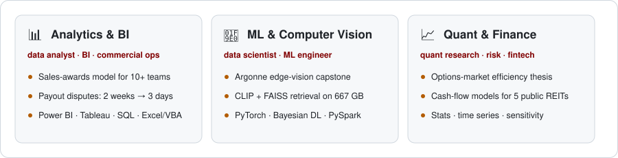
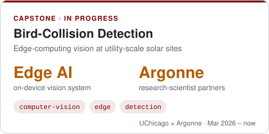
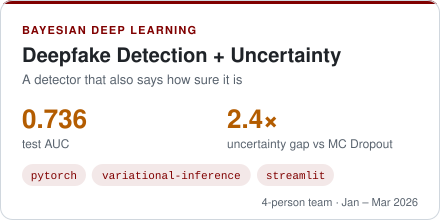
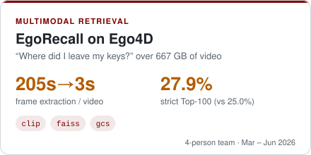
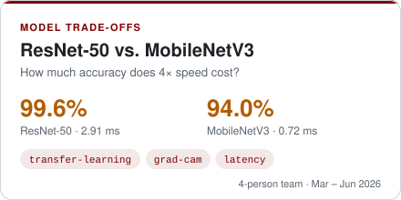
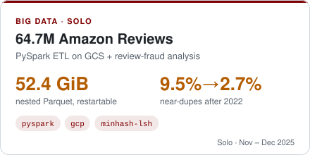
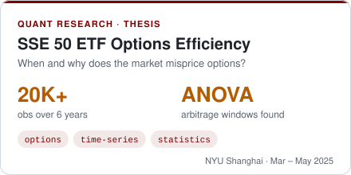
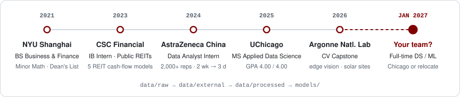

<a name="readme"></a>

<picture><source media="(prefers-color-scheme: dark)" srcset="assets/hero-dark.svg"></picture>

<p align="center">
  <a href="https://www.linkedin.com/in/gaoyuan-gu-uchi"></a>
  <a href="mailto:gugaoyuan03@gmail.com"></a>
  
  
</p>

I started in **business and finance** (NYU Shanghai, then internships at AstraZeneca and CSC Financial) and moved into **data science** at UChicago. I like problems where the data is big or messy and the answer has to hold up in a business meeting: **PySpark pipelines over tens of millions of rows**, **vision models that run on edge devices**, and **Bayesian models that say how sure they are**.

<sub>🍪 This profile is laid out like a <a href="https://cookiecutter-data-science.drivendata.org/">Cookiecutter Data Science</a> project: <code><a href="#fit">README</a> · <a href="#models">models/</a> · <a href="#data">data/</a> · <a href="#stack">pyproject.toml</a> · <a href="#make">Makefile</a></code></sub>

<a name="fit"></a>
### 🎯 Where I fit

<picture><source media="(prefers-color-scheme: dark)" srcset="assets/fit-dark.svg"></picture>

<a name="models"></a>
### 🧠 `models/` · Selected projects

<table>
  <tr>
    <td width="50%"><a href="#models"><picture><source media="(prefers-color-scheme: dark)" srcset="assets/card-argonne-dark.svg"></picture></a></td>
    <td width="50%"><a href="https://github.com/GyGu-0314/Deepfake-Bayesian-Detection"><picture><source media="(prefers-color-scheme: dark)" srcset="assets/card-deepfake-dark.svg"></picture></a></td>
  </tr>
  <tr>
    <td width="50%"><a href="https://github.com/GyGu-0314/ego-recall"><picture><source media="(prefers-color-scheme: dark)" srcset="assets/card-egorecall-dark.svg"></picture></a></td>
    <td width="50%"><a href="#models"><picture><source media="(prefers-color-scheme: dark)" srcset="assets/card-edge-dark.svg"></picture></a></td>
  </tr>
  <tr>
    <td width="50%"><a href="#models"><picture><source media="(prefers-color-scheme: dark)" srcset="assets/card-amazon-dark.svg"></picture></a></td>
    <td width="50%"><a href="#models"><picture><source media="(prefers-color-scheme: dark)" srcset="assets/card-thesis-dark.svg"></picture></a></td>
  </tr>
</table>

<details>
<summary><b>📓 Project notes</b> (methods and results in more detail)</summary>

<br>

**🦅 Bird-collision detection · Argonne National Laboratory capstone** · *Mar 2026 – now*
- I'm working with Argonne research scientists on an edge-computing vision system for utility-scale solar facilities.
- I scoped the analytic framework, data requirements and evaluation criteria. Now I'm cutting false alarms by separating true collisions from other triggers.

**🎭 [Bayesian deepfake detection](https://github.com/GyGu-0314/Deepfake-Bayesian-Detection)** · *4-person team · Jan – Mar 2026* · <sub>upstream: [khalil-he](https://github.com/khalil-he/Deepfake-Bayesian-Detection)</sub>
- Curated DeepfakeEval2024 (1,952 images, stratified 932 / 234 / 786) and extracted 2,048-d frozen Xception features.
- Built the Bayes-by-Backprop head and tuned 12 KL-weight / prior configurations. Results: test AUC 0.736, a 2.4× wider uncertainty gap than MC Dropout, and +3.2 pp accuracy after rejecting the 20% most uncertain predictions.

**🎥 [EgoRecall: visual memory retrieval on Ego4D](https://github.com/GyGu-0314/ego-recall)** · *4-person team · Mar – Jun 2026* · <sub>upstream: [khadijahslawal](https://github.com/khadijahslawal/ego-recall)</sub>
- Built the data pipeline for 1,743 videos (667 GB). A hybrid cluster-seek method cut frame extraction from 205 s to about 3 s per video, and tar-bundling 246K frames cut GCS transfer from 2+ hours to minutes.
- CLIP / BLIP-ITM + FAISS retrieval with candidate-window search and temporal smoothing reached 27.9% strict Top-100 (CLIP baseline 25.0%, coverage ceiling about 67%).

**📱 ResNet-50 vs. MobileNetV3** · *4-person team · Mar – Jun 2026*
- Fine-tuned both on a 53-class card dataset (7.6K images): 99.6% vs. 94.0% accuracy at 2.91 vs. 0.72 ms/image. Grad-CAM showed where each model was looking.

**🛒 64.7M Amazon reviews: generative AI and review fraud** · *solo · Nov – Dec 2025*
- Batched, restartable PySpark ETL over 52.4 GiB of nested Parquet on GCS that joins 64.7M reviews with 4.1M products.
- In EDA, the top 3 categories held 83% of volume and price barely tracked rating (r = 0.06). MinHash LSH (Jaccard ≥ 0.7) showed near-duplicates falling from 9.5% to 2.7% after 2022, so I recommended behavioral fraud signals over text similarity.

**📈 Market efficiency in the SSE 50 ETF options market** · *bachelor's thesis · NYU Shanghai · 2025*
- Aligned options, index and risk-free rate series into a 6-year dataset (20K+ observations), then used one-way ANOVA to separate systematic mispricing from noise and find recurring arbitrage windows.
- Also published: *The Dynamic Interplay of Market Forces and Human Behavior* (sole author, AEMPS, 2023).

</details>

<a name="data"></a>
### 🗂️ `data/` · How I got here

<picture><source media="(prefers-color-scheme: dark)" srcset="assets/timeline-dark.svg"></picture>

<details>
<summary><b>💼 Experience details</b></summary>

<br>

**AstraZeneca China** · Data Analyst Intern, Commercial Ops (Incentive Compensation) · *Shanghai · Jun – Aug 2024*
- Built the 2024 full-year Sales Awards model from scratch for 10+ sales teams, combining each team's rules into one semi-automated model.
- Python tools (calculation-trail lookup, auto-drafted replies to 400+ inquiry emails) cut payout dispute turnaround from 2 weeks to 3 days.
- Reconciled monthly payouts for 2,000+ reps, caught about 5 errors per month before they reached Finance, and reported results in Power BI.

**CSC Financial** · Investment Banking Intern, Public REITs Fund · *Shenzhen · Jun – Aug 2023*
- Built cash-flow forecasting models for 5 public REITs, including a sub-project of the Shenzhen Metro REIT, and stress-tested occupancy and rent assumptions.
- Put 10+ listed companies' filings into one quantitative framework for target screening.

**Education**
- **University of Chicago**: MS Applied Data Science, GPA 4.00 / 4.00 · *2025 – Dec 2026*
- **NYU Shanghai**: BS Business &amp; Finance, Minor in Mathematics, GPA 3.70, Dean's List · *2021 – 2025*

</details>

<a name="stack"></a>
### 🧰 `pyproject.toml` · Stack

<p>


</p>

```toml
[project.optional-dependencies]
# learning now, autumn 2026
learning-now = ["airflow", "kafka", "spark-ml", "langchain", "rag", "vector-dbs", "mcp"]
```

<a name="make"></a>
### ⚙️ `Makefile`

```make
make data       ## PySpark ETL at scale: 52.4 GiB → 64.7M analysis-ready rows
make train      ## CNNs, CLIP retrieval, Bayesian heads, with uncertainty included
make report     ## Power BI / Tableau → a decision someone can act on
make hire       ## → gugaoyuan03@gmail.com · linkedin.com/in/gaoyuan-gu-uchi · from Jan 2027
```

<p align="center"><sub>🍪 Built on the <a href="https://cookiecutter-data-science.drivendata.org/">Cookiecutter Data Science</a> layout · images generated by <a href="scripts/build_assets.py"><code>scripts/build_assets.py</code></a></sub></p>
